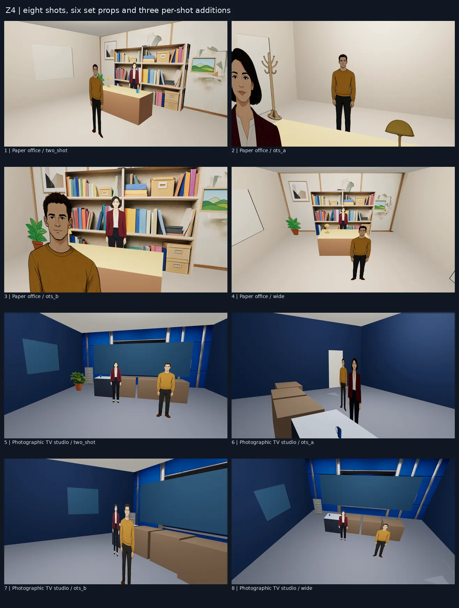
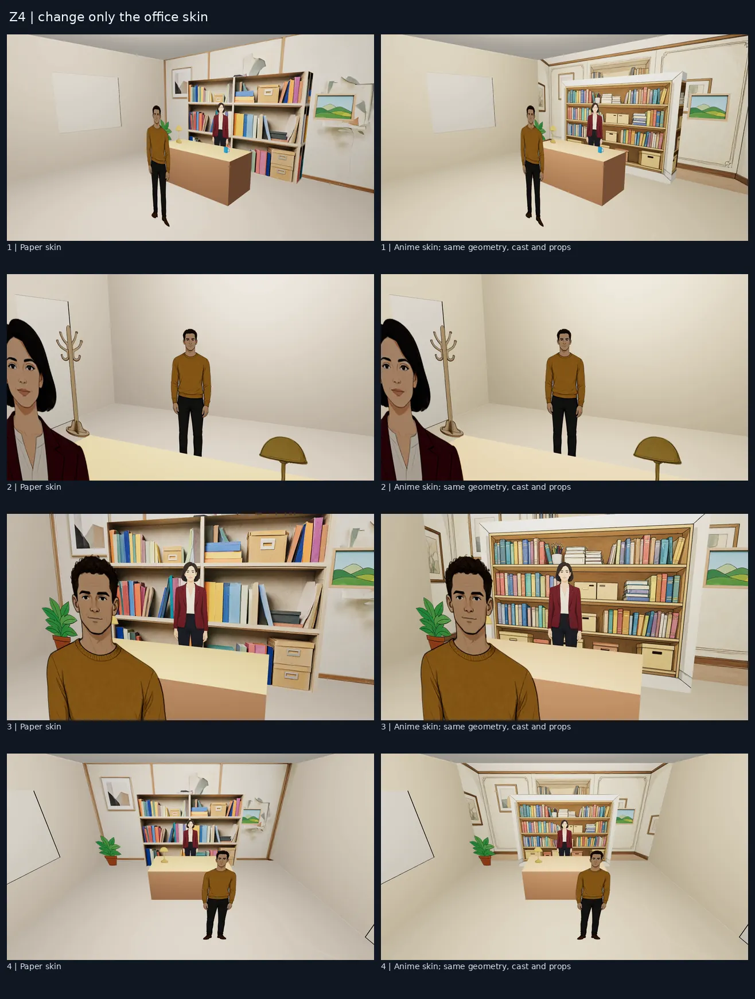
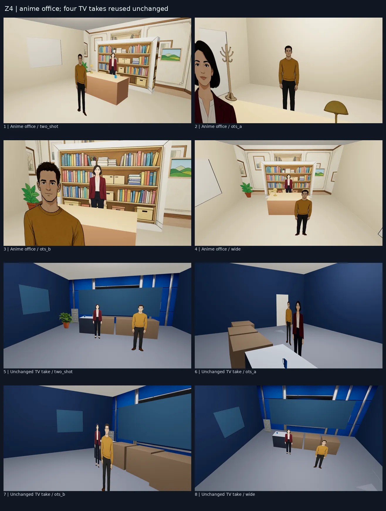

# Aceptación completa de escenarios 3D — 2026-10-11

La prueba Z4 terminó con dos MP4 de ocho planos y una comparación del cambio de piel. Toda la autoría —serie, localizaciones, pieles, episodio, adiciones, render y montaje— pasó por MCP. La extracción de fotogramas, la hoja de contactos y la comprobación de los MP4 usan herramientas locales. No se editó a mano la biblioteca de escenas ni el episodio.

## Escena de prueba

Serie `series_z4_acceptance`, dos personajes originales, Ana y Leo, en todos los planos. Ocho tomas de tres segundos, sin diálogo ni audio. Dos interiores:

| Planos | Interior | Piel | Atrezo heredado |
|---|---|---|---|
| 1–4 | Despacho, medium | Cartulina | Lámpara 0,42 m sobre la mesa, maceta en el suelo, cuadro en la pared |
| 5–8 | Plató de tele, medium | Realista | Archivador en el suelo, taza sobre la mesa, cuadro en la pared |

Adiciones por plano: taza en el plano 1, perchero en el 2 y maceta realista en el 5. Hay **seis objetos heredados y tres adiciones**, comprobados con los datos guardados por MCP. Las cuatro cámaras de cada interior son `two_shot`, `ots_a`, `ots_b` y `wide`. Los personajes están en las marcas del molde.

## Cambio exclusivo de piel

Solo se cambió `office.set3d.skin` de cartulina a anime, reutilizando las superficies ya generadas en Z3. Se mantuvieron el estilo global de la serie, los personajes, el tamaño, el molde, las cámaras y todo el atrezo.

Comprobación guardada en `/mnt/outputs/astra-sets/z4/verification.json`:

- Hash de geometría y props: `7f64f79bd815244f2d732c9b3c545ff02e594a0c9e56d9f4c27591854f9757b5` antes y después.
- Hash de contenido de planos, excluyendo tomas, aprobaciones y la huella derivada de la piel: `33127ed82386d00b318f61c0300610388b5e4aaa68328eff63d9de5ff64aef9f` antes y después.
- Se invalidaron únicamente las cuatro aprobaciones del despacho y se renderizaron cuatro tomas nuevas.
- Los cuatro identificadores de toma aprobada del plató se conservaron exactamente; toda esa localización quedó idéntica.
- La piel se reconstruyó desde los recursos existentes: **cero generaciones nuevas** al pasar a anime.

Los cambios más visibles están en la pared del fondo y la estantería. El contraplano hacia la pared frontal de color liso cambia muy poco, como corresponde a su material.

## Tiempos medidos

| Operación Z4 | Tiempo total s | Inferencia nueva de imágenes s |
|---|---:|---:|
| Construir despacho con recursos existentes | 4.331 | 0 |
| Generar pared del plató, 1536×704 | 13.309 | 13 |
| Construir plató con pared ya generada | 4.346 | 0 |
| Render de ocho planos | 140.917 | 0 |
| Primer montaje | 8.128 | 0 |
| Cambiar piel del despacho a anime | 4.425 | 0 |
| Render de cuatro planos modificados | 76.777 | 0 |
| Segundo montaje | 8.109 | 0 |

GPU: RTX 4090, Qwen Image 2.1 Viggle Turbo, 6 pasos. La columna de inferencia procede de los metadatos de la aplicación; el render usa el navegador y FFmpeg y se informa por tiempo transcurrido, sin atribuir todo ese tiempo a kernels GPU. Se verificó antes de cada admisión que no hubiera otra GPU ocupada por encima de 2 GB ni producciones activas en :42042.

## MP4 y evidencia

Ambos archivos son H.264, 1920×1080, 24 fps; incluyen los márgenes del montaje. `ffprobe` verifica formato, dimensiones, frecuencia y duración, y una decodificación completa con FFmpeg termina sin errores.

- `/mnt/outputs/astra-sets/final/z4-paper-and-realistic.mp4`: 25.208 s.
- `/mnt/outputs/astra-sets/final/z4-anime-and-realistic.mp4`: 25.208 s.
- `/mnt/outputs/astra-sets/final/a7-four-shots.mp4`: prueba anterior de cuatro cámaras.
- Hojas de contactos PNG completas: `/mnt/outputs/astra-sets/contacts/z4-paper-and-realistic.png`, `z4-anime-and-realistic.png` y `z4-skin-only-comparison.png`.
- Solicitudes, respuestas, trabajos y pruebas de invariantes: `/mnt/outputs/astra-sets/z4/`, `mcp-transcript.jsonl` y `gpu-guard.jsonl`.

## Hallazgos y estado de aceptación

P1 corregidos durante las aceptaciones: negativos incompatibles de Viggle generaban personas en los props (#971); interiores oscuros y cast tratado como fondo (#969/#975); pared frontal ausente en contracampos (#974). Cada corrección se propagó por la pila y se volvió a exportar la evidencia. Detalle y capturas en [las aceptaciones por bloque](SETS_BLOQUES_2026-10-11.md).

P2 abiertos de calidad visual: los muebles siguen siendo bloques hasta recibir una piel detallada; los recortes 2.5D mantienen su dibujo al mirar desde detrás; los huecos sin una vista asignada usan su color por defecto. El croma puede comerse colores del sujeto y exige revisar candidatos. Los objetos de una pared pueden quedar ocluidos por mobiliario o por la pantalla del plató según la cámara. Estas limitaciones se ven en las capturas y no se ocultan con retoques.

En los fotogramas revisados, los dos interiores son distinguibles y no se observan penetraciones evidentes de los personajes en el mobiliario. Las bases y alturas se verifican en los datos de las escenas. **La aceptación visual definitiva corresponde al usuario al ver los MP4 y las hojas de contactos; todavía no se ha emitido.**

## Entrega y comprobaciones

A1–A8 tienen PRs en borrador #969–#976, el informe Z2/Z3 está en #977, y esta rama `docs/sets-acceptance` contiene Z4. No se ha fusionado ningún PR. Z1 ejecutó las suites completas en orden; las correcciones tienen regresiones dirigidas, ratchet y documentación verificados. La CI actual se comprueba en los estados de cada PR antes de la entrega.

Por petición posterior del usuario, :42042 se actualizó con el código final en la rama local `preview/astra-sets-42042`, commit `b9435598`, conservando proyectos y el `start.js` local. Pinokio confirma estado online, UI HTTP 200 y los 15 moldes completos. :42003 no se modificó. El servidor aislado :42070 quedó detenido al terminar los renders para liberar recursos.

## Coste de la tarea

- Tests simulados: 0 tokens externos.
- Tests reales: Z2, Z3 y Z4, con calibraciones y renders repetidos incluidos en los registros.
- Llamadas LLM externas: 0.
- Tokens de prompt: N/A.
- Tokens de respuesta: N/A.
- Tokens totales de Codex y del agente limpio: N/A, sin contador fiable expuesto.
- Generaciones de imágenes/audio/vídeo por modelos: **77 / 0 / 0**, en 44 trabajos de imágenes; incluye 18 imágenes de calibración. Z4 añadió una pared.
- Render local: 75 registros de exportación 3D completada conservados, cuatro montajes completados y un intento inicial fallido por Chromium ausente. Son renders y montajes, no generaciones de vídeo por un modelo.
- Tiempo de inferencia de imágenes acumulado: **684 s**. Tiempos de cada fase en las tablas y JSON; no se estima el tiempo de revisión ni se suman relojes solapados.
- Proveedores/modelos: locales, Qwen Image 2.1 Viggle Turbo, U2Net/croma, Chromium y FFmpeg.
