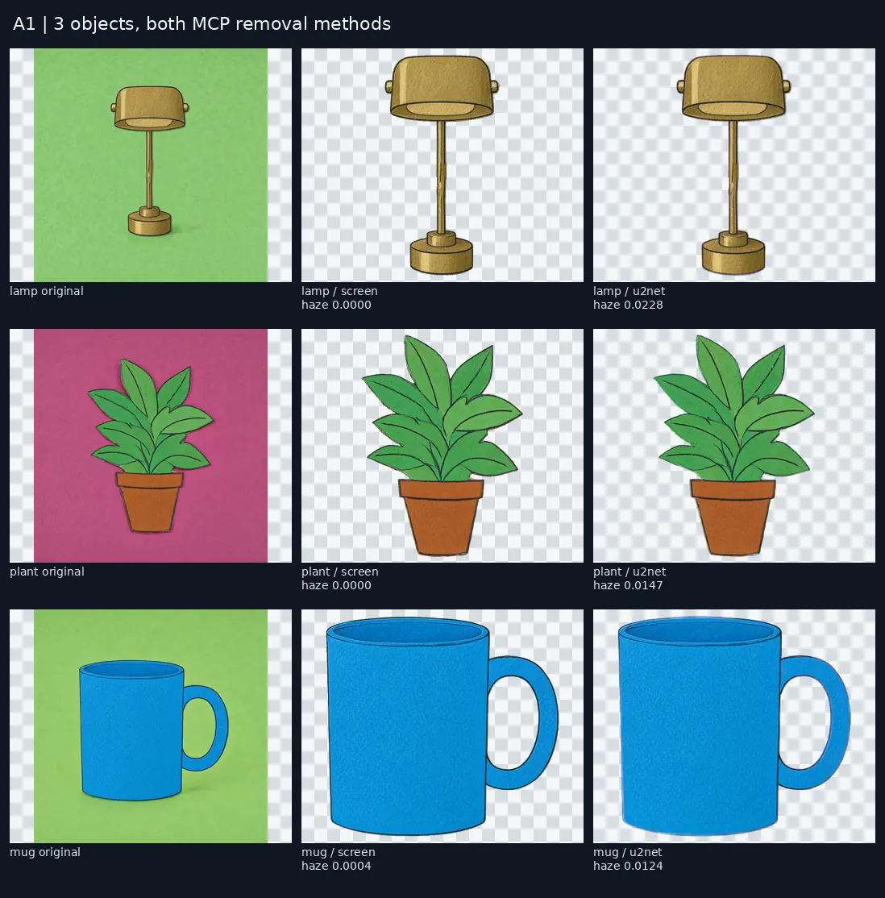
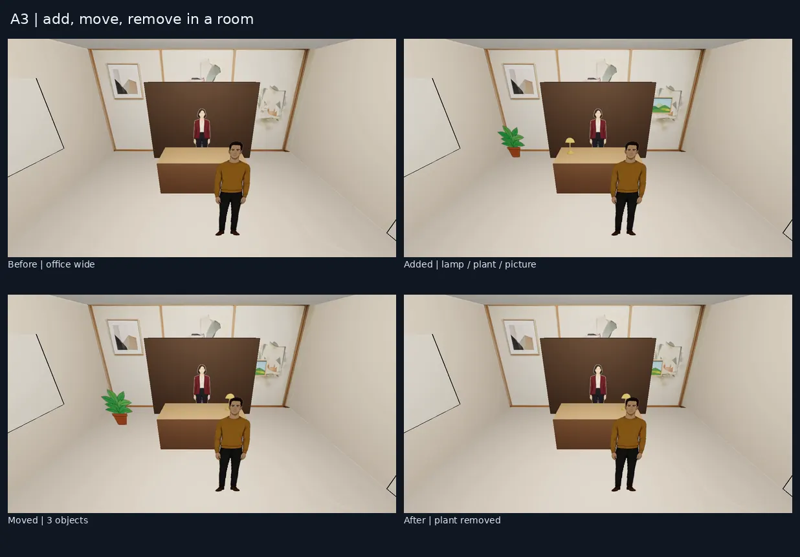
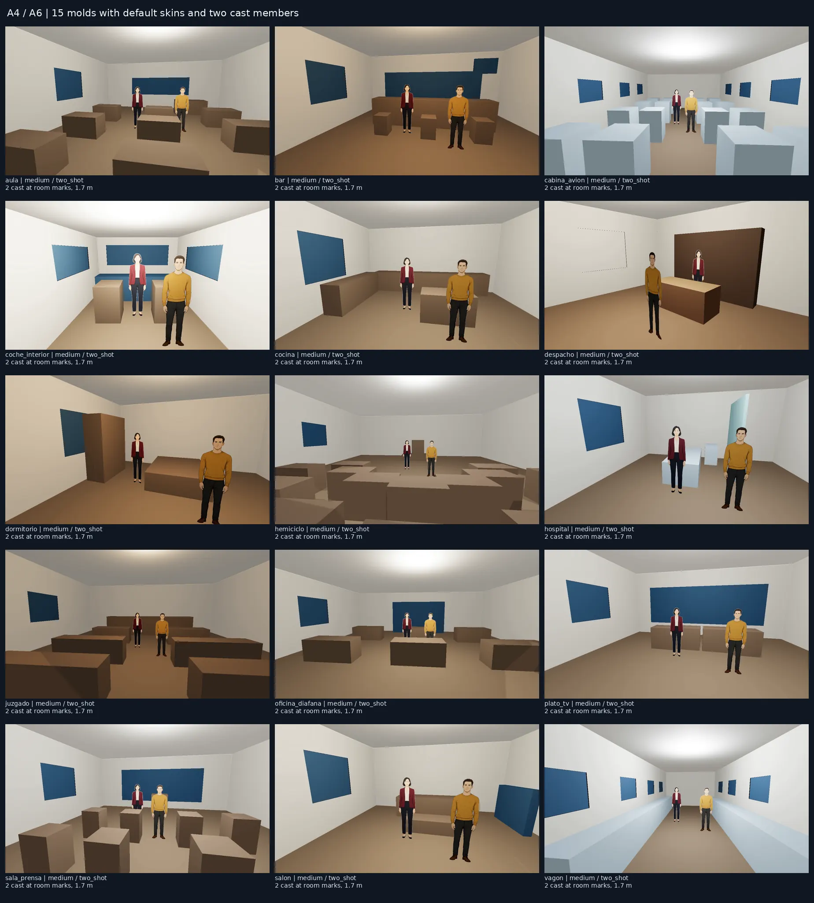
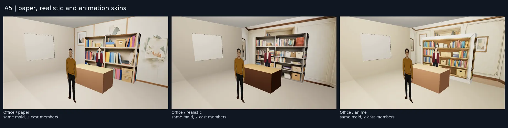
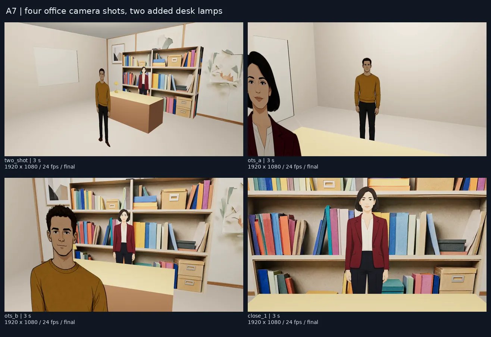

# Aceptaciones por bloque — 2026-10-11

Z3 realizado mediante MCP en `127.0.0.1:42070`, workspace `astra-sets`, después de escribir A1–A8 y completar Z1/Z2. Los fotogramas proceden de exportaciones reales del navegador; no son previsualizaciones geométricas simplificadas.

## A1 y A2: recorte y biblioteca

Lámpara, maceta y taza recortadas con los dos métodos, a partir de los mismos originales. Ninguna supera el límite de haze. Se conserva el original, la respuesta MCP y el tiempo de cada petición.

| Objeto | Método | Tiempo s | Haze |
|---|---|---:|---:|
| lamp | screen | 0.410 | 0.00000 |
| lamp | u2net | 2.560 | 0.02277 |
| plant | screen | 0.494 | 0.00000 |
| plant | u2net | 1.405 | 0.01472 |
| mug | screen | 0.464 | 0.00042 |
| mug | u2net | 1.561 | 0.01241 |

A2 reutiliza la prueba real de Z2: 24 trabajos, 48 candidatos, seis objetos en dos estilos y dos fondos, con 12 objetos aprobados. Supera los diez objetos requeridos. Tiempos y ejemplos en [la prueba de defaults](SETS_TRIAL_2026-10-11.md).

## A3: edición de una escena existente

Una escena de despacho recibió lámpara sobre `desk_left`, maceta en `corner` y cuadro en `wall_picture`. Se movieron los tres y se eliminó la maceta. Las cuatro exportaciones muestran el antes, la adición, el movimiento y la eliminación. La base de la lámpara queda a 0,75 m, coincidiendo con la mesa; las posiciones y alturas se conservan en las respuestas MCP.

## A4 y A6: quince moldes

Los 15 interiores se construyeron con sus pieles por defecto, tamaño `medium`, cámara `two_shot` y dos personajes originales en las primeras dos marcas. Exportación 1280×720, 30 fps, un segundo por molde. El catálogo completo tiene tres tamaños y siete cámaras por molde. No se ha aplicado una pose sentada a los recortes de prueba: la prueba geométrica de marcas sentadas es independiente.

Los contracampos revelaron que tres paredes no bastaban: 13 de los 15 moldes tenían alguna cámara mirando hacia la abertura frontal. Se añadió esa pared a los 15 interiores y una regresión que prolonga cada cámara hasta el límite de la habitación, en los tres tamaños. Antes fallaban 13 casos; ahora pasan los 34 tests Python de moldes y los cinco del visor.

## A5: mismo despacho, tres pieles

| Piel | Construcción s | Inferencia nueva s | Imágenes nuevas |
|---|---:|---:|---:|
| Cartulina | 20.468 | 16 | 1: frente de estantería; pared reutilizada de Z2 |
| Realista | 20.598 | 16 | 1: frente de estantería; pared reutilizada de Z2 |
| Anime | 28.894 | 24 | 2: pared y frente de estantería |

El molde, las marcas, la cámara y los personajes son los mismos. El reloj de inferencia procede de los metadatos de la aplicación; no mide por separado cada kernel CUDA.

## A7: episodio de cuatro planos

`series_z3_episode4`, episodio `episode_8d8bf4599f10484aaa309ea2e3dd6482`: cuatro planos de tres segundos, dos personajes, cámaras `two_shot`, `ots_a`, `ots_b` y `close_1`. Lámpara añadida al primer plano y otra al tercero por el agente limpio A8. Sin diálogo ni audio. Las cuatro tomas están renderizadas y aprobadas por el flujo de prueba.

Render final: 80.44 s; montaje: 8.11 s. MP4: 1920×1080, 24 fps, 12.833 s incluyendo el margen del montaje. Archivo externo: `/mnt/outputs/astra-sets/final/a7-four-shots.mp4`.

## A8: agente MCP limpio

El agente comenzó sin historial ni acceso al repositorio. Solo se le proporcionó el transporte genérico, el servidor y el plano objetivo. Descubrió el uso con `tools/list` y `series.guide`; después consultó las herramientas necesarias.

Transcripción corta:

1. `tools/list` → descubre las operaciones; `series.guide` → explica biblioteca, anclajes y alturas.
2. `series.shot.get` → plano 3, `e1s02`, despacho, cámara `ots_b`.
3. `props.list` → lámpara aprobada `prop-ed53a72dbd044b44-2`, altura 0,42 m.
4. `scene3d.sets.catalog` → `desk_left = [-0.6, 0.75, -0.8]`, máximo 0,5 m.
5. `scene3d.item.add` → `item.prop` anterior, `at.anchor: desk_left`, destino plano 3.
6. `scene3d.item.list` y `series.shot.get` → objeto persistido, base sobre la mesa, `warnings: []`, aprobación anterior invalidada.

Resultado **PASS**. Dieciséis llamadas, incluidas lecturas repetidas; cero generaciones. Registro íntegro fuera del repo: `z3/a8-clean-agent.jsonl`; relato detallado: `z3/a8-clean-agent.md`. La nueva toma se renderizó posteriormente en la prueba A7.

## Correcciones que exigió la prueba real

- P1 corregido en #969: el techo tapaba la luz exterior. El molde aporta luz ambiental y una luz interior bajo el techo.
- P1 corregido en #975 y #969: personajes silenciosos o imágenes de producción podían interpretarse como fondo. Se conserva su material `cutout` y el apoyo en el suelo; la identidad de plantilla incluye el documento compilado.
- P1 corregido en #974: los contracampos mostraban el exterior negro por falta de pared frontal.
- P2 conservado: los moldes son geometría de bloques; la piel aporta el detalle. Un recorte 2.5D no produce una vista trasera o una pose sentada nueva al girarlo.
- P2 de Z2: revisar colores del objeto antes de aceptar croma y revisar perspectiva de las paredes generadas.

## Evidencia y coste

Todos los datos están en `/mnt/outputs/astra-sets/`: `z3/moldv3-*`, `z3/a3cast-*`, `z3/skin-*`, `z3/episode4-*-v2.json`, `contacts/` y `mcp-transcript.jsonl`. Los originales y metadatos están en el workspace de medios del worktree. Las capturas anteriores se conservan para comparar las correcciones.

Acumulado Z2+Z3: **76 imágenes originales**, 43 trabajos de generación, 671 s de inferencia registrada; seis imágenes adicionales respecto a Z2 (dos personajes y cuatro superficies). 63 registros de exportación 3D completada conservados, incluidos los renders repetidos al corregir los fallos; una exportación inicial falló por navegador ausente y se repitió tras instalar Chromium. Sin generaciones de audio ni vídeo por modelos. Los MP4 son renders 3D y montajes locales. Tokens externos: 0; tokens Codex: N/A. Ningún PR fusionado. La aceptación visual final del usuario corresponde a Z4.
