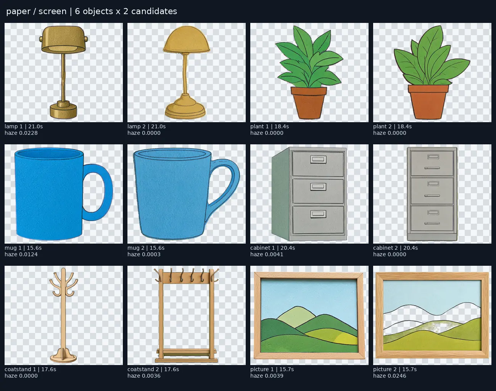
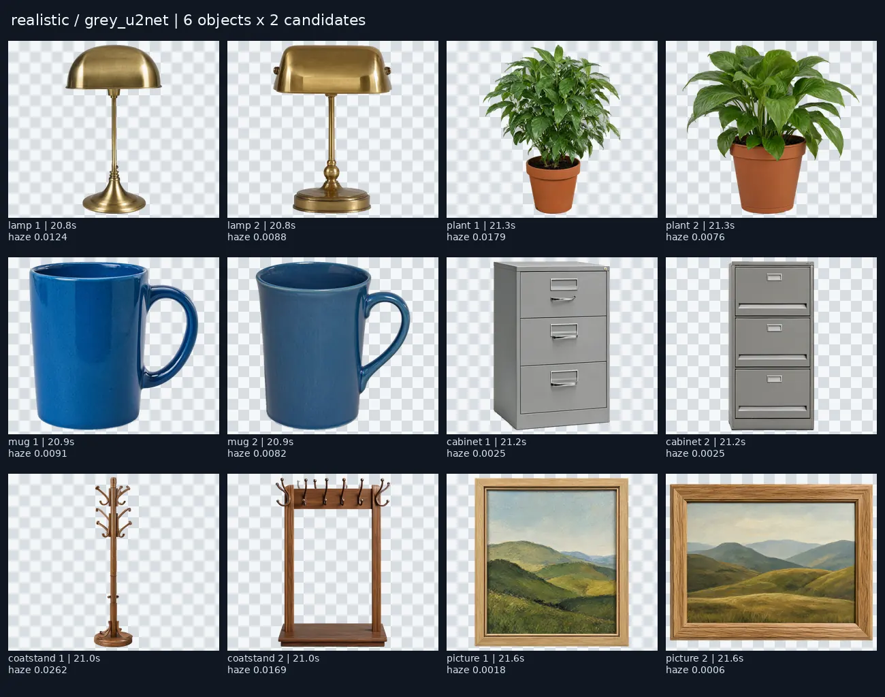
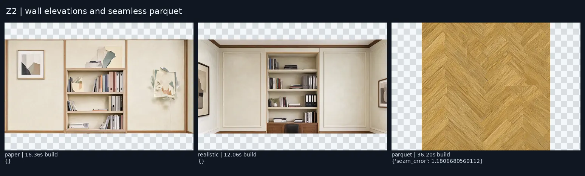
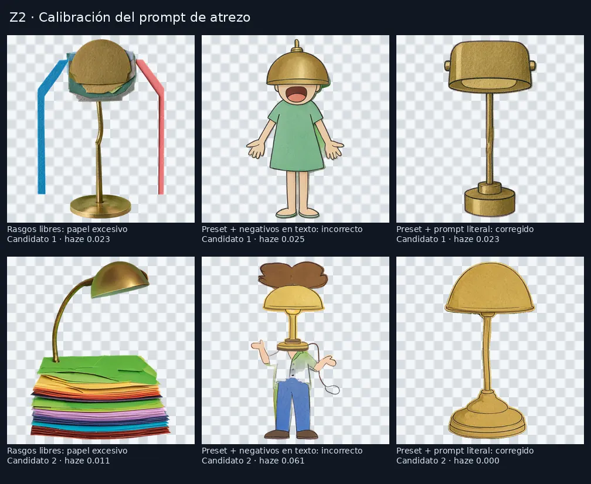

# Prueba de escenarios 3D — 2026-10-11

Z2 ejecutado en el worktree aislado `astra-sets`, servidor `127.0.0.1:42070`, workspace `astra-sets`.
RTX 4090, Qwen Image 2.1 Viggle Turbo instalado, 6 pasos, CFG 1, semilla 1. Modelos del vivo enlazados con escritura denegada por Landlock; UI y medios propios. Antes de cada lote se comprobó la GPU y que :42042 no tuviera producciones activas.

## Atrezo: 24 trabajos, 48 imágenes

Seis objetos por estilo: lámpara, maceta, taza, archivador, perchero y cuadro. Dos candidatos por petición, resolución 1024×1024. Todas las creaciones y aprobaciones pasan por MCP. Los tiempos de trabajo incluyen generación y recorte; GPU es el reloj de inferencia registrado por la aplicación, no un perfil de kernels CUDA.

| Estilo | Fondo solicitado | Media s/trabajo (2 imágenes) | GPU s/6 trabajos | Haze medio / máximo | Recorte elegido por auto |
|---|---|---:|---:|---:|---|
| paper | screen | 18.11 | 91.51 | 0.0060 / 0.0246 | {'u2net': 4, 'screen': 8} |
| realistic | screen | 13.57 | 74.78 | 0.0051 / 0.0515 | {'screen': 12} |
| paper | grey_u2net | 20.34 | 94.01 | 0.0113 / 0.0220 | {'u2net': 12} |
| realistic | grey_u2net | 21.14 | 98.58 | 0.0095 / 0.0262 | {'u2net': 12} |

Se conservan los defaults `screen` para estilos planos y `grey_u2net` para pintados/realistas. Se ajusta únicamente `removeBackground.colorDistance`: **70 → 190**. Los verdes generados no son RGB verde puro: percentiles 99 de distancia 179 y 187 en las muestras de calibración. Un gris neutro tiene distancia mínima 208 al verde puro; los 24 recortes sobre gris eligieron U2Net. El método auto conserva su alternativa a U2Net cuando el borde no alcanza el 90 % de coincidencia.

El haze es una medida del alfa, no una nota estética. El croma puede eliminar verdes del propio objeto: un cuadro de cada estilo perdió parte de sus colinas; no se eligieron esos candidatos. U2Net mantuvo los cuadros completos. Un perchero alternativo resultó ser un armario-perchero: se escogió el candidato exento. Hay 12 objetos revisados y aprobados, seis por estilo.

## Paredes y parqué

| Superficie | Resolución | Construcción total s | Inferencia registrada s |
|---|---|---:|---:|
| paper | 1536×768 | 16.356 | 13.000 |
| realistic | 1536×768 | 12.064 | 8.000 |
| parquet | 1024×1024 | 36.200 | 30.000 |

El parqué pasó desplazamiento de media imagen, inpaint de cruz y desplazamiento inverso: una pasada, `seam_error = 1.180668`, inferior a `seamMax = 1.5`. No fue necesario cambiar resolución, umbral ni pasadas. Repetir exactamente la piel reutilizó los ficheros; reconstrucción de plantillas en 4.088 s, **0 generaciones adicionales**.

## Hallazgos y correcciones

- **P1 corregido en #971:** Viggle no admite negativos. Añadirlos al prompt positivo hacía aparecer personas (lámpara con cuerpo humano). Ahora se conserva el positivo literal; regresión de admisión y 20 pruebas dirigidas pasan. Misma semilla y preset antes/después en la captura.
- **P2:** estilos escritos como largas listas de rasgos pueden producir papel apilado en vez del objeto. El preset `paper-cutout` da objetos reconocibles.
- **P2:** el croma puede eliminar colores presentes en el sujeto. Revisar ambos candidatos o elegir U2Net; el sistema no aprueba automáticamente.
- **P2:** la pared realista conserva un pequeño tramo de techo y una silla pese al prompt frontal. La aceptación de escena completa comprueba el efecto a escala.

## Evidencia reproducible

Raíz externa: `/mnt/outputs/astra-sets/`. `trial/props-summary.json` conserva cada trabajo y su procedencia; `trial/prop-metrics.json`, `trial/skin-metrics.json`, `trial/approved-props.json`, `mcp-transcript.jsonl` y `gpu-guard.jsonl` conservan medidas y llamadas. Hojas completas en `contacts/props-{paper,realistic}-{screen,grey_u2net}.png` y `contacts/walls-and-parquet.png`. Los originales y metadatos están en `/mnt/outputs/hocuspocus-worktrees/astra-sets/app/outputs/astra-sets/`.

## Coste de la tarea

- Tests simulados: 0 tokens externos.
- Tests reales: 24 trabajos de atrezo, 9 trabajos de calibración, 4 imágenes de piel (dos paredes, parqué y su inpaint); sin audio ni vídeo en Z2.
- Llamadas LLM externas: 0.
- Tokens de prompt, respuesta y totales de Codex: N/A (sin contador expuesto).
- Generaciones de imágenes/audio/vídeo: **70 / 0 / 0**, incluidas las 18 imágenes de calibración.
- Tiempo: desglose medido en las tablas y JSON; los tiempos de revisión humana no se estiman.
- Proveedores/modelos: local, `qwen_image_21_viggle_turbo`; U2Net y croma para recortar.
